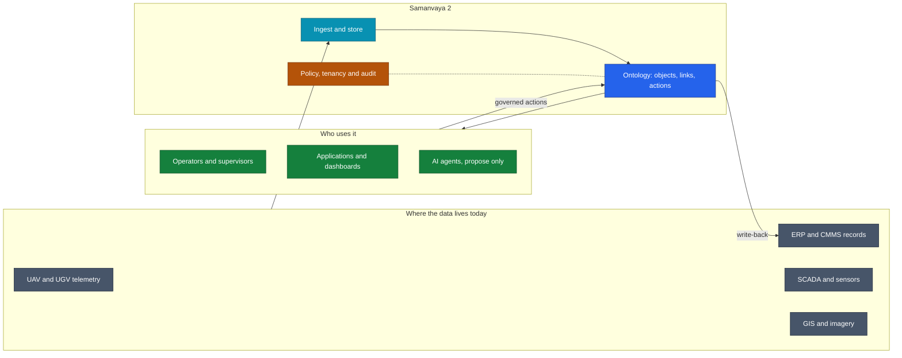
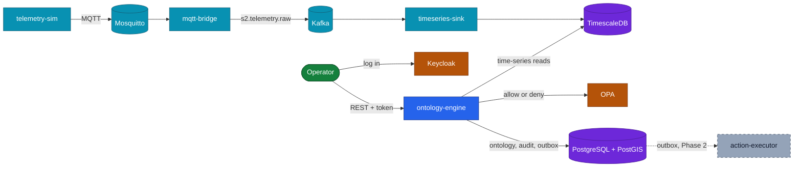
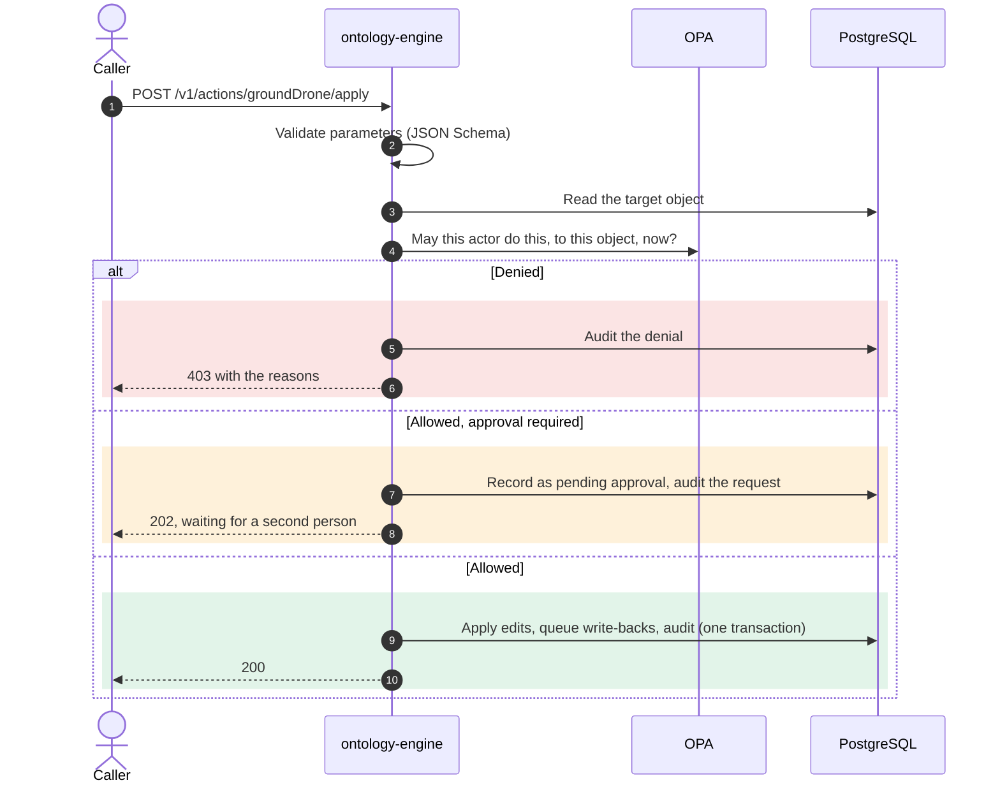
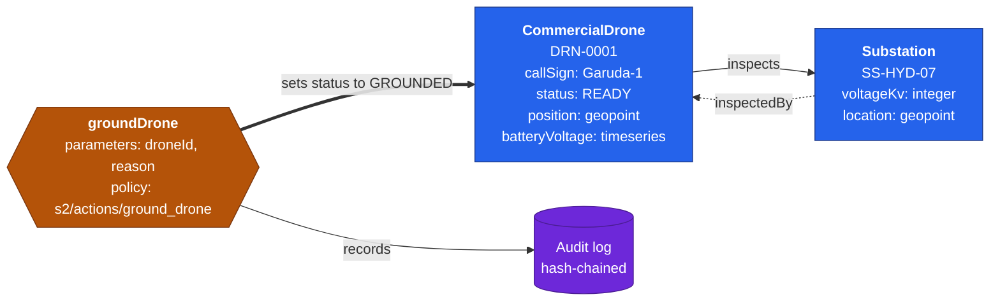
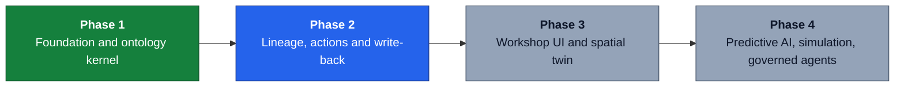

<div align="center">

# Samanvaya 2 (S2)

**An open-source enterprise data operating system and operational digital twin for civilian industry**

[](https://github.com/veerendra-saraswathi/S2/actions/workflows/ci.yml)


[What it is](#what-it-is) · [Architecture](#architecture) · [Terminology](#terminology) · [Tech stack](#tech-stack) · [Quick start](#quick-start) · [Roadmap](#roadmap)

</div>

## What it is

Industrial operators hold their picture of the world in pieces: drone and robot telemetry in one place, asset records in an ERP, work orders in a CMMS, measurements in SCADA, maps in a GIS. S2 joins those pieces into one typed model of the business, called an **ontology**, that people and software can query, act on and audit.

It is built for civilian commercial work: utility grid inspection, smart manufacturing and warehouse logistics, civil infrastructure monitoring, precision agriculture.



Samanvaya 0.5 and 1 run the fleet itself: field telemetry and edge autonomy for commercial UAVs and UGVs. S2 sits above them. The telemetry contract in this repository is a placeholder of S2's own and has not yet been aligned with Samanvaya 0.5.

Three ideas carry the design:

| | Idea | What it means in practice |
|---|---|---|
| 🧩 | **Model the business, not the tables** | A drone, a substation and the fact that one inspects the other are first-class, typed things with an API, whatever systems the data came from. |
| 🛡️ | **Every change is a governed action** | Nobody edits state directly. A change is a named action with validated parameters, a policy decision, and where required a second person's approval. |
| 🔗 | **Everything is on the record** | Each action, approval and denial is written to an append-only, hash-chained audit log that can be re-verified at any time. |

## Status

Phase 1 of 4: foundation and ontology kernel. One vertical slice works end to end and has been run on a real Docker stack: telemetry in, objects and links out, a policy-checked action with two-person approval, and a verified audit chain.

| Area | State |
|---|---|
| Ontology engine: registry, objects, links, governed actions, audit chain | 🟢 Built and tested |
| Ingestion: MQTT bridge, Kafka log, TimescaleDB sink, telemetry simulator | 🟢 Built and tested |
| Policies (OPA / Rego) for actions, with four-eyes approval | 🟢 Built and tested |
| Local stack (Docker Compose) | 🟢 Boots and runs the slice on Docker Desktop for macOS |
| Helm chart (ontology engine only) | 🟡 Written, not yet linted or installed |
| Workshop UI | 🟡 Application shell only (Phase 3) |
| Action executor (write-back delivery) | ⚪ Stub: write-backs are queued, nothing delivers them yet (Phase 2) |
| Pipeline orchestrator, lakehouse and lineage | ⚪ Stub (Phase 2) |
| AI, simulation and governed agents | ⚪ Stub (Phase 4) |

What was and was not verified, and how, is recorded in [docs/scaffold-verification.md](docs/scaffold-verification.md).

## Architecture

The [specification](docs/architecture/spec.md) describes seven layers. This is where each one stands today.

| # | Layer | In this repository | State |
|---|---|---|---|
| 1 | Ingestion and connector fabric | `services/ingestion-connectors` | 🟢 MQTT telemetry path. CDC, batch and ERP connectors come in Phase 2 |
| 2 | Lakehouse and lineage | `services/pipeline-orchestrator` | ⚪ Object store is provisioned but unused until Phase 2 |
| 3 | Operational ontology | `services/ontology-engine`, `ontologies/` | 🟢 Object types, properties, links, actions, instances |
| 4 | Time-series, geospatial, media | TimescaleDB and PostGIS, read through the engine | 🟡 Time-series and one geometry per object. Media indexing later |
| 5 | AI, simulation, governed agents | `services/ai-simulation` | ⚪ Schema and policies already treat agents as propose-only |
| 6 | Workshop application builder | `apps/workshop-ui` | 🟡 Shell |
| 7 | Security, access control, audit | `packages/s2-common`, `policies/`, engine | 🟡 Login, roles, policy on actions, tenant isolation and audit chain. [Known gaps](docs/architecture/overview.md#security-model-and-known-gaps) |

### What runs today

Two paths meet at the ontology engine. Telemetry flows in from the field and lands in TimescaleDB. People and software act through the engine, which is the only writer of ontology state.



Colour key: teal is ingestion, blue is the ontology engine, amber is identity and policy, violet is storage, green is a person, grey dashed is planned.

### What happens when someone requests an action



- **One transaction.** The edits, the queued write-backs and the audit entry commit together or not at all.
- **One policy decision.** "May this person do it" and "may it be done to this object now" are the same OPA query, and its decision id is stored with the audit entry.
- **Fail closed.** If OPA is unreachable or returns anything other than a clean allow, nothing executes.
- **Approval is decided again.** A pending action is re-evaluated when approved, against the current state, and the requester cannot approve their own request.
- **Agents propose.** An action open to AI agents must require human approval.

More detail is in the [architecture overview](docs/architecture/overview.md) and the [decision records](docs/architecture/adr/README.md).

## Terminology

The example below is the demo data that `make seed` loads.



| Term | Meaning |
|---|---|
| **Ontology** | The typed model of the business: what kinds of things exist, how they relate, and what may be done to them. |
| **Object type** | A class of thing, such as `CommercialDrone` or `Substation`. Each real drone or substation is an **object** of that type, identified by its primary key. |
| **Property** | A typed field on an object type: text, number, date, a map point or shape, a media reference, or a time-series. A time-series property is a pointer to a metric in TimescaleDB, not a stored value. |
| **Link type** | A named relationship between two object types, readable in both directions (`inspects` / `inspectedBy`). |
| **Action type** | A governed change: a schema for its parameters, the edits it makes, the write-backs it queues, and the policy that guards it. |
| **Pack** | Ontology as code. A YAML file under [`ontologies/`](ontologies/README.md) that defines object, link and action types and is applied through the API. |
| **Governed action** | An action request that has passed parameter validation and a policy decision, and has been audited. This is the only way ontology state changes. |
| **Four-eyes approval** | Some actions need a second person. The requester cannot approve their own request. |
| **Policy** | A rule written in Rego and evaluated by OPA that allows or denies an action, with reasons. |
| **Write-back** | A message to an external system (ERP, CMMS, fleet) produced by an action. It is queued in an **outbox** in the same transaction as the change, to be delivered afterwards. |
| **Audit chain** | An append-only log in which each entry carries a hash of the one before it, so any edit, reordering or gap is detectable. |
| **Tenant** | One customer organisation. PostgreSQL row-level security keeps each tenant's ontology data invisible to the others. |
| **Operational digital twin** | The live, queryable picture of physical assets that results: current state, history, position and relationships. |

## Tech stack

| Concern | Technology | Role in S2 |
|---|---|---|
| API and domain logic | Python 3.13, FastAPI, Pydantic, SQLAlchemy 2, Alembic | The ontology engine and its database migrations |
| Ontology store | PostgreSQL 18 with PostGIS | Definitions, objects (JSONB), links, geometry, audit log, outbox |
| Time-series | TimescaleDB | Telemetry readings and positions |
| Field messaging | MQTT (Eclipse Mosquitto locally) | Telemetry from vehicles and sensors |
| Event log | Apache Kafka (KRaft, no ZooKeeper) | Durable, replayable log between ingestion and storage |
| Identity | Keycloak (OpenID Connect) | Login, tokens, roles, tenant claim |
| Policy | Open Policy Agent, Rego | Allow or deny on every action |
| Object storage | SeaweedFS (S3-compatible) | Provisioned for the Phase 2 lakehouse and media |
| User interface | React, TypeScript, Vite, Tailwind CSS | Workshop UI shell |
| Packaging and tooling | uv workspace, pnpm, Ruff, pytest | One monorepo for services, packages and the UI |
| Deployment | Docker Compose (local), Helm (Kubernetes) | Local stack today; chart for the engine |
| Continuous integration | GitHub Actions | Lint, tests, policy tests |

Planned for later phases, per the specification: Apache Iceberg with Dagster and dbt (Phase 2), MapLibre and CesiumJS views (Phase 3), MLflow and simulation (Phase 4).

## Quick start

Requirements: Docker with Compose v2.24 or newer, `make`, `curl`. About 6 GB of free memory and a few spare CPU cores for the full stack; Kafka is slow to start on a machine that is already busy.

```bash
make up      # build and start everything; the first run pulls images
make seed    # apply the ontology packs, create demo drones and substations
make sim     # start publishing synthetic telemetry
```

Then try the slice. Dev users are `admin`, `operator`, `supervisor`, `approver`, `auditor` and `viewer`; each password is the user name followed by `-dev`.

```bash
API=http://localhost:8000
OPERATOR=$(make -s token AS=operator)
auth() { echo "Authorization: Bearer $1"; }

# An object, with its position and properties
curl -s -H "$(auth $OPERATOR)" $API/v1/objects/CommercialDrone/DRN-0003

# Its telemetry, straight from TimescaleDB (the simulator degrades this drone's actuators)
curl -s -H "$(auth $OPERATOR)" "$API/v1/objects/CommercialDrone/DRN-0003/timeseries/actuatorHealth?limit=5"

# Follow a link, in either direction
curl -s -H "$(auth $OPERATOR)" $API/v1/objects/CommercialDrone/DRN-0001/links/inspects
curl -s -H "$(auth $OPERATOR)" $API/v1/objects/Substation/SS-HYD-07/links/inspectedBy

# A governed action: validated, policy-checked, applied, queued for write-back, audited
curl -s -X POST -H "$(auth $OPERATOR)" -H 'Content-Type: application/json' \
  -d '{"parameters": {"droneId": "DRN-0003", "reason": "actuator health trending down"}}' \
  $API/v1/actions/groundDrone/apply

# The same request as a viewer is denied by policy, and the denial is audited too
curl -s -X POST -H "$(auth $(make -s token AS=viewer))" -H 'Content-Type: application/json' \
  -d '{"parameters": {"droneId": "DRN-0002", "reason": "just testing"}}' \
  $API/v1/actions/groundDrone/apply

# Returning the drone to service needs a second person
EXEC=$(curl -s -X POST -H "$(auth $OPERATOR)" -H 'Content-Type: application/json' \
  -d '{"parameters": {"droneId": "DRN-0003"}}' $API/v1/actions/returnDroneToService/apply \
  | python3 -c 'import json,sys; print(json.load(sys.stdin)["id"])')
curl -s -X POST -H "$(auth $(make -s token AS=approver))" $API/v1/action-executions/$EXEC/approve

# The audit chain, and proof it has not been altered
AUDITOR=$(make -s token AS=auditor)
curl -s -H "$(auth $AUDITOR)" "$API/v1/audit?limit=5"
curl -s -H "$(auth $AUDITOR)" $API/v1/audit/verify
```

Interactive API documentation: <http://localhost:8000/docs>. Keycloak console: <http://localhost:8080> (`admin` / `admin_dev`).

`make help` lists every target. `make down` stops the stack; `make nuke` also deletes its data.

## Repository layout

```
services/
  ontology-engine/        FastAPI: registry, objects, actions, audit; Alembic migrations
  ingestion-connectors/   mqtt-bridge (MQTT -> Kafka), timeseries-sink (Kafka -> TimescaleDB)
  action-executor/        stub: outbox relay and ERP / CMMS write-back        (Phase 2)
  pipeline-orchestrator/  stub: Dagster + dbt over the Iceberg lakehouse      (Phase 2)
  ai-simulation/          stub: model bindings, what-if simulation, agents    (Phase 4)
packages/
  s2-common/              settings, OIDC token verification, OPA client, logging
apps/
  workshop-ui/            React + TypeScript + Tailwind shell                 (Phase 3)
ontologies/               ontology-as-code packs (YAML): core-fleet, energy-grid
policies/                 OPA policies and their tests
tools/
  telemetry-sim/          synthetic UAV / UGV telemetry publisher
deploy/
  docker-compose/         the local stack and its support files
  helm/s2/                Kubernetes chart (ontology engine)
docs/
  architecture/           spec, overview, decision records (adr/)
```

## Development

Python 3.13 with [uv](https://docs.astral.sh/uv/) (it installs the interpreter if you lack it); Node 22+ with pnpm for the UI.

```bash
make sync         # create .venv with every workspace package, editable
make lint         # ruff check + format check
make test         # unit tests; database and policy tests skip unless configured
make test-stack   # every test, using the running Compose stack as the backend
make policy-test  # Rego unit tests (needs the opa binary)
make ui           # Workshop UI dev server on http://localhost:5173
```

The integration tests use a real PostgreSQL and a real OPA; how to point them at one is described at the top of [services/ontology-engine/tests/conftest.py](services/ontology-engine/tests/conftest.py). To change the ontology schema, edit the models and add an Alembic revision (see [services/ontology-engine/README.md](services/ontology-engine/README.md)). To add object types or actions, edit or add a pack under [ontologies/](ontologies/README.md).

## Roadmap



- **Phase 1 (current):** monorepo, local stack, ontology registry, telemetry path, governed actions, audit chain.
- **Phase 2:** the action executor delivers queued write-backs to ERP and CMMS systems; the pipeline orchestrator brings the Iceberg lakehouse, lineage and dataset branching; access control on reads.
- **Phase 3:** the Workshop UI: ontology explorer, map and timeline views, action-driven triage.
- **Phase 4:** predictive models bound to object types, what-if simulation, governed AI agents, external anchoring of the audit chain.

## Security notes for the local stack

The Compose stack is for development on one machine. It uses default passwords, no TLS, an anonymous MQTT broker, plaintext Kafka, a public Keycloak client that allows the password grant, and a superuser connection to the telemetry database. None of that is acceptable beyond localhost. Known gaps in the platform itself (property markings recorded but not yet enforced on reads, no row-level security on telemetry, audit chain not yet anchored externally) are listed in the [overview](docs/architecture/overview.md#security-model-and-known-gaps).

## Licence

[Apache License 2.0](LICENSE).
