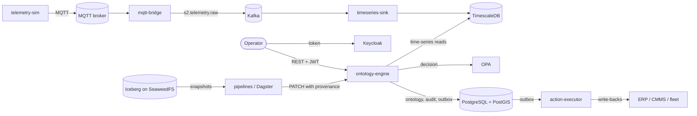
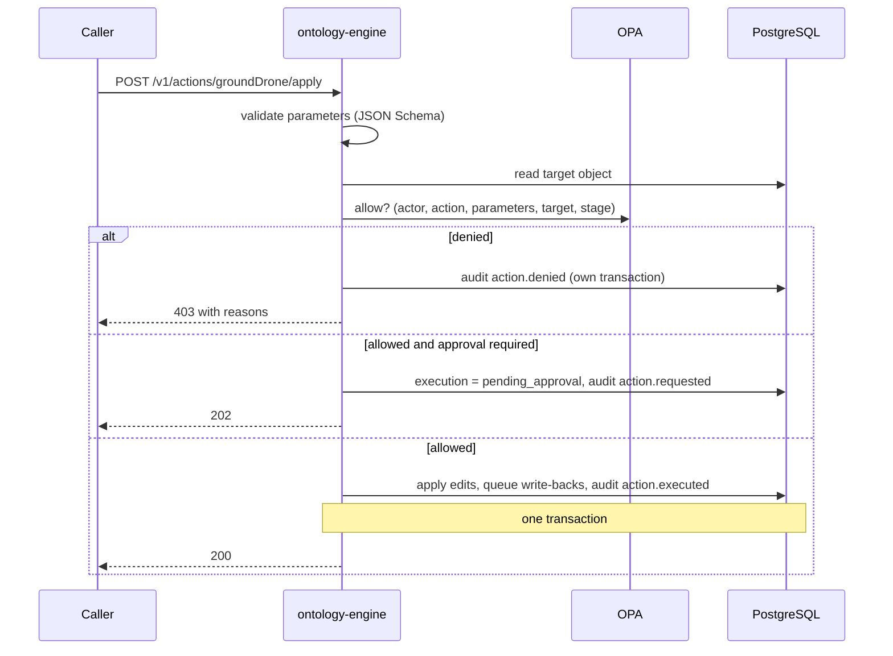

# S2 architecture overview

This document describes what exists in the repository today and how it maps to the [specification](spec.md). Decisions and their reasons are in the [decision records](adr/README.md).

## From the specification's seven layers to this repository

| Spec layer | Where it lives | State |
|---|---|---|
| 2.1 Ingestion and connector fabric | `services/ingestion-connectors` | MQTT telemetry path built. CDC, batch and ERP connectors: Phase 2 |
| 2.2 Lakehouse and lineage | `services/pipeline-orchestrator`, object store in the stack | Iceberg datasets (SQL catalog, files on SeaweedFS), branches, sync into objects through the API with provenance, Dagster lineage ([ADR 0011](adr/0011-lakehouse-catalog-and-sync.md)) |
| 2.3 Operational ontology | `services/ontology-engine`, `ontologies/` | Built: object types, properties, links, actions, instances |
| 2.4 Time-series, geospatial, media | TimescaleDB + PostGIS, read through the engine | Time-series and one geometry per object built. Media indexing: later |
| 2.5 AI, simulation, governed agents | `services/agent-runtime`, `services/ai-simulation` | Governed agents built ([ADR 0015](adr/0015-governed-agents.md)); models and simulation not yet |
| 2.6 Workshop application builder | `apps/workshop-ui` | Shell |
| 2.7 Security, access control, audit | `packages/s2-common`, `policies/`, engine | OIDC, role checks, OPA on actions, tenant RLS, audit chain built. See gaps below |

## The Phase 1 vertical slice

Two paths meet at the ontology engine. Telemetry flows in from the field and lands in TimescaleDB keyed by object. People and software act through the engine, which is the only writer of ontology state.

## The ontology

Definitions (the metamodel) and instances live in the `ontology` schema of PostgreSQL.

- **Object type**: a class of thing (`CommercialDrone`, `Substation`). Has typed **properties**, exactly one of which is the primary key.
- **Property**: `string`, `integer`, `double`, `decimal`, `boolean`, `date`, `timestamp`, `json`, `geopoint`, `geoshape`, `timeseries`, `media_ref`. A `timeseries` property is a binding to a metric in TimescaleDB, not a stored value. A geo property is stored in PostGIS.
- **Link type**: a directional relationship with a name in each direction (`inspects` / `inspectedBy`) and a cardinality.
- **Action type**: a governed mutation: a JSON Schema for its parameters, an ordered list of ontology edits, write-backs to enterprise systems, and the OPA policy that guards it.

Definitions are authored as **packs** (`ontologies/*/pack.yaml`) and applied through the API. Applying is idempotent and never destroys what data depends on: a removed property becomes `deprecated`, and a change that would reinterpret stored data is refused.

Object instances keep scalar properties in JSONB, validated against the property definitions on every write, with one PostGIS geometry column. See [ADR 0004](adr/0004-ontology-storage.md) for why, and what it costs.

## What happens when an action is requested

Points worth knowing:

- **One transaction.** The edits, the outbox rows and the audit entry commit together or not at all. Enterprise systems cannot join that transaction, so write-backs are queued in `writeback_outbox` and delivered afterwards, at-least-once, with the outbox row id as the idempotency key ([ADR 0005](adr/0005-actions-and-outbox.md)).
- **One policy decision.** Authorisation ("may this person do it") and business rules ("may it be done to this object now") are the same OPA query. The decision id is stored on the audit entry.
- **Approval is re-decided.** A pending action is evaluated again when approved, against the current state, with the approver as actor. The requester cannot approve their own request.
- **Fail closed.** If OPA is unreachable or returns anything other than a clean allow, nothing executes.
- **Agents propose.** An action open to AI agents must require human approval; this is enforced when the action is defined, in the policy baseline, and by a database constraint. An agent must give a rationale, and neither it nor the person it acts for may approve its proposal.

## Telemetry

Readings are keyed by the natural key `(tenant, object type, primary key, metric)`, not by an ontology id. Ingestion therefore never calls the ontology, and telemetry may arrive before its object is registered. Kafka sits between the MQTT bridge and every store so that data can be replayed and reprocessed; the sink's inserts are idempotent, so replays are harmless ([ADR 0008](adr/0008-telemetry-path.md)).

The telemetry contract is [v1](../../contracts/telemetry/v1/README.md), frozen: JSON Schema for the topic and payload, and conformance cases. `services/ingestion-connectors/src/s2_ingest/contracts.py` implements it and is tested against those cases. It was written before the real Samanvaya 0.5 topics and payloads were available; a difference from them becomes v2, not an edit to v1.

## Security model and known gaps

What is enforced today:

- **Authentication**: OIDC access tokens from Keycloak, verified by signature (asymmetric algorithms only), issuer, audience and expiry.
- **Tenancy**: every ontology row carries `tenant_id`; PostgreSQL row-level security compares it with a transaction-local setting taken from the token. Without a tenant, a session sees and writes nothing. The services connect as a non-owner role. The engine checks this at startup and refuses to run as a superuser or any role that bypasses row-level security.
- **Authorisation**: realm roles gate the administrative endpoints; OPA gates every action.
- **Audit**: an append-only, per-tenant hash chain. The application role cannot update or delete entries; triggers stop even the owner; `GET /v1/audit/verify` re-walks the chain.

What is not, yet:

- **Markings on reads** are enforced for objects, links, series reads and audit entries ([ADR 0010](adr/0010-markings-on-reads.md)). Not yet covered: write-back payloads in the outbox, action parameters, and telemetry outside the API.
- **Telemetry isolation.** The telemetry tables have no row-level security; the engine filters by tenant in its queries, and in the local stack connects as a superuser.
- **Audit anchoring.** The chain shows edits, reordering and gaps. It cannot show that the newest entries were removed unless its head hash is also kept outside the database. That is planned with the Phase 4 hardening.
- **Read auditing.** Mutations and denials are audited; queries are not.
- **Transport security and secrets** are out of scope for the local stack.

## Roadmap, as it applies to this repository

- **Phase 2** (in progress): `action-executor` delivers the outbox ([ADR 0009](adr/0009-action-executor.md); built, with HTTP, log, Maximo and SAP PM connectors, [ADR 0012](adr/0012-cmms-adapters-and-sync-identity.md)); `pipeline-orchestrator` brings the Iceberg lakehouse, dataset branching and lineage (built, [ADR 0011](adr/0011-lakehouse-catalog-and-sync.md), [ADR 0012](adr/0012-cmms-adapters-and-sync-identity.md); dbt and incremental sync not yet); read-side access control from markings (built, [ADR 0010](adr/0010-markings-on-reads.md)).
- **Phase 3** (in progress): the Workshop UI ([ADR 0013](adr/0013-workshop-ui.md)). Built: ontology explorer, objects with live series, triage queues ([ADR 0014](adr/0014-triage-rules.md)), map, actions, approval queue, audit log. Still to do (paused for Phase 4): live updates, timeline view, 3D.
- **Phase 4** (in progress): governed agents built ([ADR 0015](adr/0015-governed-agents.md)). Next: predictive models bound to object types, what-if simulation on a branch of the ontology, audit anchoring.
